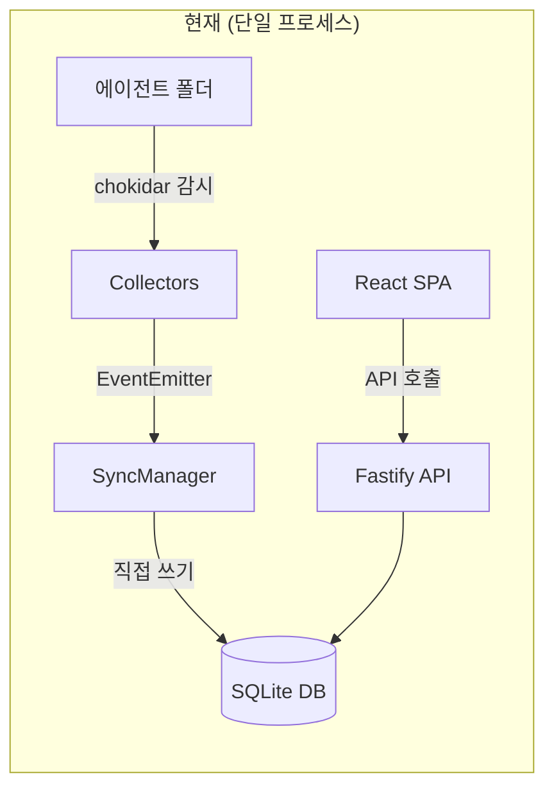
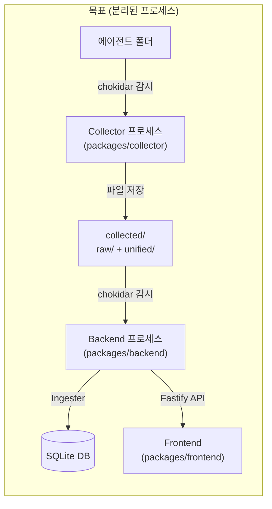
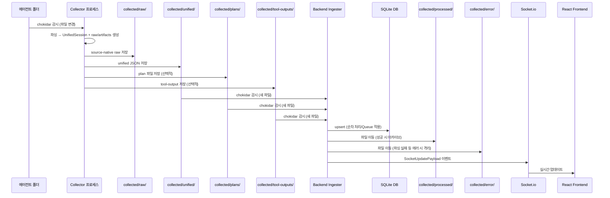

# Synapse 모노레포 재설계 — 구현 계획

AI 데이터 수집기(Collector)를 백엔드에서 분리하고, 프로젝트를 Bun workspace 기반 모노레포로 재구조화합니다.

## 현재 아키텍처 vs 목표 아키텍처





---

## User Review Required

> [!IMPORTANT]
> **Breaking Change: DB 초기화 vs 마이그레이션**
> Grill-me 세션에서 Drizzle 마이그레이션으로 기존 데이터를 보존하기로 결정했습니다. 하지만 스키마 변경 범위가 크므로 (테이블 삭제, 컬럼 변경 등) 마이그레이션 복잡도가 상당할 수 있습니다. 마이그레이션 작업 중 문제가 발생하면 클린 스타트로 전환할 수 있는 대안도 준비해두겠습니다.

> [!WARNING]
> **기존 `src/` 디렉토리 완전 대체**
> 이 작업은 기존 `src/backend`, `src/frontend`, `src/shared`를 `packages/` 하위로 이동합니다. Git history는 보존되지만 모든 import 경로가 변경됩니다.

> [!IMPORTANT]
> **CopilotCollector의 `bun:sqlite` 의존성**
> CopilotCollector는 Copilot CLI의 SQLite DB를 직접 읽으므로 `bun:sqlite`에 의존합니다. Collector 패키지가 Bun 런타임에서 실행되어야 하는 제약이 있습니다 (이미 현재도 그러합니다).

---

## Design Decisions

> [!IMPORTANT]
> **경로 기준 고정**: Collector와 Backend는 모두 **repo root 기준 절대 경로**를 사용합니다. `process.cwd()` 기준 상대 경로는 금지하고, `SYNAPSE_ROOT` 또는 `config.ts`의 repo root 탐지 로직으로 `data/collected/`와 DB 경로를 계산합니다. 이렇게 해야 `bun run --filter ...`로 각 패키지를 개별 실행해도 동일한 디렉토리를 바라봅니다.

> [!IMPORTANT]
> **수집 폴더 기본 경로**: 기본값은 프로젝트 루트의 `data/collected/`로 확정합니다. 홈 디렉토리 전역 저장소는 이번 구조 변경에서는 채택하지 않습니다.

> [!IMPORTANT]
> **DB 파일명 변경**: 기본 DB 파일명은 `synapse.db`로 통일합니다. 기존 `gemini-monitor.db`가 있고 `synapse.db`가 없으면 최초 실행 시 1회 복사/rename 마이그레이션을 수행하거나, 필요 시 `DATABASE_URL`로 기존 파일을 명시적으로 지정합니다.

> [!WARNING]
> **코드 조사에서 발견된 추가 이슈 (이번 재설계 시 함께 해결)**
> 1. **Collector 타입 불일치**: `ClaudeCollector`와 `CodexCollector`가 `UnifiedMessage` 타입에 없는 필드(`thoughts`, `inputTokens`, `outputTokens`)를 직접 할당 중 — `@synapse/shared` 타입 통합 시 수정 필요
> 2. **Socket.io 페이로드 불일치**: `SyncManager.onUpdate`가 `sessionData` 전체를 전송하지만, 프론트엔드 `App.tsx`는 `SocketUpdatePayload` 형식을 기대 — Ingester 재작성 시 수정
> 3. **리브랜딩 미완**: `package.json` name이 `gemini-monitor-app`, DB 파일이 `gemini-monitor.db`, `index.html` title이 `Gemini Monitor` — 이번에 `synapse`로 통일
> 4. **레거시 `syncer.ts`**: 삭제된 `thoughts`, `toolCalls` 테이블을 import하여 잠재적 런타임 오류 가능 — 삭제 대상에 포함됨

---

## Proposed Changes

총 4개 패키지로 분리하고, 루트 설정 파일을 재구성합니다.

### Phase 1: 모노레포 구조 초기화

루트 workspace 설정과 패키지 디렉토리 구조를 만듭니다.

---

#### [NEW] [package.json](file:///C:/Users/hdmun/repo/synapse/package.json) (루트, 기존 파일 교체)

루트 `package.json`을 workspace 관리용으로 교체합니다.

```json
{
  "name": "synapse",
  "private": true,
  "workspaces": ["packages/*"],
  "scripts": {
    "dev": "concurrently \"bun run dev:collector\" \"bun run dev:backend\" \"bun run dev:frontend\"",
    "dev:collector": "bun run --filter @synapse/collector dev",
    "dev:backend": "bun run --filter @synapse/backend dev",
    "dev:frontend": "bun run --filter @synapse/frontend dev",
    "build": "bun run --filter @synapse/frontend build",
    "test": "bun run --filter '*' test",
    "db:generate": "bun run --filter @synapse/backend db:generate",
    "db:migrate": "bun run --filter @synapse/backend db:migrate"
  },
  "devDependencies": {
    "concurrently": "^9.2.1",
    "typescript": "^5.7.3"
  }
}
```

#### [NEW] [bunfig.toml](file:///C:/Users/hdmun/repo/synapse/bunfig.toml)

Bun workspace 루트 설정 파일.

#### [MODIFY] [.gitignore](file:///C:/Users/hdmun/repo/synapse/.gitignore)

`data/` 디렉토리를 gitignore에 추가합니다.

---

### Phase 2: `packages/shared` — 공통 타입 & 설정

Collector와 Backend 모두가 참조하는 공통 타입, Zod 스키마, 설정 모듈을 분리합니다.

---

#### [NEW] packages/shared/package.json

```json
{
  "name": "@synapse/shared",
  "version": "0.1.0",
  "type": "module",
  "exports": {
    ".": {
      "import": "./src/index.ts",
      "types": "./src/index.ts"
    }
  }
}
```

#### [NEW] packages/shared/tsconfig.json

```json
{
  "extends": "../../tsconfig.base.json",
  "compilerOptions": {
    "outDir": "./dist",
    "rootDir": "./src"
  },
  "include": ["src"]
}
```

#### [MOVE] [schema.ts](file:///C:/Users/hdmun/repo/synapse/src/shared/schema.ts) → `packages/shared/src/schema.ts`

기존 `src/shared/schema.ts`를 이동합니다. `UnifiedSession`, `UnifiedMessage`, `TokenTaxonomy` 등 Collector 타입도 이 패키지로 통합합니다.

#### [NEW] packages/shared/src/types.ts

기존 `src/backend/services/collectors/types.ts`의 `UnifiedSession`, `UnifiedMessage`, `Collector`, `CollectorEvents` 타입을 이동합니다.

추가로 raw 보존과 부가 아티팩트(plan/tool-output) 처리를 위해 아래 타입을 도입합니다.

- `CollectedEvent`: `{ session: UnifiedSession; raw: unknown; artifacts?: CollectedArtifact[] }`
- `CollectedArtifact`: source별 부가 파일(`plan`, `tool-output`, 기타 첨부 메타데이터)을 표현

Collector의 `session-update` 이벤트는 `UnifiedSession` 단독이 아니라 `CollectedEvent`를 내보내도록 변경합니다.

#### [NEW] packages/shared/src/config.ts

Collector와 Backend가 공유하는 설정 모듈. 수집 폴더 경로, 에이전트 소스 경로, DB 경로 등.

```typescript
import path from 'path';

export interface SynapseConfig {
  repoRoot: string;            // 모노레포 루트 절대 경로
  collectedDir: string;       // collected/ 루트
  rawDir: string;             // collected/raw/
  unifiedDir: string;         // collected/unified/
  processedDir: string;       // collected/processed/
  errorDir: string;           // collected/error/ (파싱 실패 등 격리)
  plansDir: string;           // collected/plans/
  toolOutputsDir: string;     // collected/tool-outputs/
  dbPath: string;             // synapse.db 경로
  agents: {
    gemini: { dir: string };
    claude: { dir: string };
    copilot: { dbPath: string };
    codex: { dir: string };
  };
}

function resolveRepoRoot(): string {
  return process.env.SYNAPSE_ROOT || path.resolve(import.meta.dir, '../../..');
}

export function loadConfig(): SynapseConfig {
  const home = process.env.USERPROFILE || process.env.HOME || '';
  const repoRoot = resolveRepoRoot();
  const collectedDir = process.env.SYNAPSE_COLLECTED_DIR || path.join(repoRoot, 'data', 'collected');
  
  return {
    repoRoot,
    collectedDir,
    rawDir: path.join(collectedDir, 'raw'),
    unifiedDir: path.join(collectedDir, 'unified'),
    processedDir: path.join(collectedDir, 'processed'),
    errorDir: path.join(collectedDir, 'error'),
    plansDir: path.join(collectedDir, 'plans'),
    toolOutputsDir: path.join(collectedDir, 'tool-outputs'),
    dbPath: process.env.DATABASE_URL || path.join(repoRoot, 'synapse.db'),
    agents: {
      gemini: { dir: process.env.GEMINI_TMP_DIR || path.join(home, '.gemini', 'tmp') },
      claude: { dir: process.env.CLAUDE_PROJECTS_DIR || path.join(home, '.claude', 'projects') },
      copilot: { dbPath: process.env.COPILOT_DB_PATH || path.join(home, '.copilot', 'session-store.db') },
      codex: { dir: process.env.CODEX_SESSIONS_DIR || path.join(home, '.codex', 'sessions') },
    },
  };
}
```

#### [NEW] packages/shared/src/index.ts

배럴 파일 (re-export).

---

### Phase 3: `packages/collector` — 독립 데이터 수집기

에이전트 파일을 감시하여 `collected/raw/<source>/`와 `collected/unified/`에 파일을 저장하는 독립 데몬 프로세스.

---

#### [NEW] packages/collector/package.json

```json
{
  "name": "@synapse/collector",
  "version": "0.1.0",
  "type": "module",
  "scripts": {
    "dev": "bun run --watch src/index.ts",
    "start": "bun run src/index.ts",
    "test": "bun test"
  },
  "dependencies": {
    "@synapse/shared": "workspace:*",
    "chokidar": "^5.0.0",
    "zod": "^4.3.6"
  }
}
```

#### [NEW] packages/collector/tsconfig.json

Bun 환경에 맞는 TypeScript 설정.

#### [NEW] packages/collector/src/index.ts (진입점)

모든 Collector를 생성하고 `FileWriter`에 연결하여 데몬으로 실행합니다.

```typescript
import { loadConfig } from '@synapse/shared';
import { GeminiCollector } from './collectors/gemini.collector';
import { ClaudeCollector } from './collectors/claude.collector';
import { CopilotCollector } from './collectors/copilot.collector';
import { CodexCollector } from './collectors/codex.collector';
import { FileWriter } from './file-writer';

async function main() {
  const config = loadConfig();
  const fileWriter = new FileWriter(config);
  
  const collectors = [
    new GeminiCollector(config.agents.gemini.dir),
    new ClaudeCollector(config.agents.claude.dir),
    new CopilotCollector(config.agents.copilot.dbPath),
    new CodexCollector(config.agents.codex.dir),
  ];

  for (const collector of collectors) {
    collector.on('session-update', (event) => fileWriter.write(event));
    collector.on('error', (err) => console.error(`[${collector.constructor.name}] Error:`, err));
    await collector.start();
  }

  // Graceful shutdown
  process.on('SIGINT', async () => {
    for (const c of collectors) await c.stop();
    process.exit(0);
  });
}

main();
```

#### [NEW] packages/collector/src/file-writer.ts

`CollectedEvent`를 받아 source-native raw, unified session, 부가 아티팩트를 각각 저장합니다.

- `collected/raw/<source>/<sessionId>.json` — source-native raw payload 보존용
- `collected/unified/<sessionId>.json` — 백엔드 소비용 (UnifiedSession 포맷)
- `collected/plans/<source>/<sessionId>/*.md` — plan 동기화용
- `collected/tool-outputs/<source>/<sessionId>/*.txt` — tool output 동기화용

```typescript
import fs from 'fs/promises';
import path from 'path';
import type { CollectedEvent, SynapseConfig } from '@synapse/shared';

export class FileWriter {
  constructor(private config: SynapseConfig) {}

  async write(event: CollectedEvent): Promise<void> {
    const { session, raw, artifacts = [] } = event;

    // 1. source-native raw 저장
    const rawDir = path.join(this.config.rawDir, session.source);
    await fs.mkdir(rawDir, { recursive: true });
    await fs.writeFile(
      path.join(rawDir, `${session.id}.json`),
      JSON.stringify(raw, null, 2), 'utf-8'
    );

    // 2. unified 저장 (백엔드가 감시하는 디렉토리)
    // 덮어쓰기 방지 및 이력 보존을 위해 타임스탬프를 추가 (Ingester가 순차 처리 후 보존)
    const timestamp = Date.now();
    await fs.mkdir(this.config.unifiedDir, { recursive: true });
    await fs.writeFile(
      path.join(this.config.unifiedDir, `${session.id}-${timestamp}.json`),
      JSON.stringify(session, null, 2), 'utf-8'
    );

    // 3. plan/tool-output 등 부가 아티팩트 저장
    for (const artifact of artifacts) {
      const baseDir =
        artifact.kind === 'plan' ? this.config.plansDir : this.config.toolOutputsDir;
      const artifactDir = path.join(baseDir, session.source, session.id);
      await fs.mkdir(artifactDir, { recursive: true });
      await fs.writeFile(path.join(artifactDir, artifact.fileName), artifact.content, 'utf-8');
    }
  }
}
```

#### [MOVE] Collector 클래스 파일들

기존 `src/backend/services/collectors/` → `packages/collector/src/collectors/`

| 원본 파일 | 대상 파일 |
|---|---|
| [base.collector.ts](file:///C:/Users/hdmun/repo/synapse/src/backend/services/collectors/base.collector.ts) | `packages/collector/src/collectors/base.collector.ts` |
| [gemini.collector.ts](file:///C:/Users/hdmun/repo/synapse/src/backend/services/collectors/gemini.collector.ts) | `packages/collector/src/collectors/gemini.collector.ts` |
| [claude.collector.ts](file:///C:/Users/hdmun/repo/synapse/src/backend/services/collectors/claude.collector.ts) | `packages/collector/src/collectors/claude.collector.ts` |
| [copilot.collector.ts](file:///C:/Users/hdmun/repo/synapse/src/backend/services/collectors/copilot.collector.ts) | `packages/collector/src/collectors/copilot.collector.ts` |
| [codex.collector.ts](file:///C:/Users/hdmun/repo/synapse/src/backend/services/collectors/codex.collector.ts) | `packages/collector/src/collectors/codex.collector.ts` |

**수정 사항**:
- import 경로를 `@synapse/shared`에서 타입 가져오도록 변경
- `message-utils.ts`(`extractMessageSummary`, `cleanMessageContent`)를 `@synapse/shared`로 이동
- `CollectorEvents`, `UnifiedSession`, `UnifiedMessage` 타입은 `@synapse/shared`에서 import
- DB 직접 참조 코드 제거 (Collector는 DB를 알 필요 없음)

#### [MOVE] 테스트 파일들

| 원본 | 대상 |
|---|---|
| [collectors.test.ts](file:///C:/Users/hdmun/repo/synapse/src/backend/services/collectors/collectors.test.ts) | `packages/collector/src/collectors/__tests__/collectors.test.ts` |
| [claude.collector.test.ts](file:///C:/Users/hdmun/repo/synapse/src/backend/services/collectors/claude.collector.test.ts) | `packages/collector/src/collectors/__tests__/claude.collector.test.ts` |

---

### Phase 4: `packages/backend` — API 서버 & Ingester

Fastify API 서버 + unified 폴더 감시 → DB 반영 역할을 합니다.

---

#### [NEW] packages/backend/package.json

```json
{
  "name": "@synapse/backend",
  "version": "0.1.0",
  "type": "module",
  "scripts": {
    "dev": "bun run --watch src/index.ts",
    "start": "bun run src/index.ts",
    "test": "NODE_ENV=test bun test",
    "db:generate": "drizzle-kit generate",
    "db:migrate": "drizzle-kit migrate"
  },
  "dependencies": {
    "@synapse/shared": "workspace:*",
    "@fastify/cors": "^11.2.0",
    "drizzle-orm": "^0.45.2",
    "fastify": "^5.8.5",
    "fastify-plugin": "^5.1.0",
    "fastify-socket.io": "^5.1.0",
    "fastify-type-provider-zod": "^6.1.0",
    "chokidar": "^5.0.0",
    "socket.io": "^4.8.3",
    "zod": "^4.3.6"
  },
  "devDependencies": {
    "drizzle-kit": "^0.31.10"
  }
}
```

#### [NEW] packages/backend/tsconfig.json

#### [NEW] packages/backend/drizzle.config.ts

```typescript
import { defineConfig } from 'drizzle-kit';
import path from 'node:path';

export default defineConfig({
  schema: './src/db/schema.ts',
  out: './drizzle',
  dialect: 'sqlite',
  dbCredentials: {
    url: process.env.DATABASE_URL || path.resolve(import.meta.dirname, '../../synapse.db'),
  },
});
```

#### [NEW] packages/backend/src/services/ingester.ts ⭐

**핵심 새 모듈.** `collected/unified/`, `collected/plans/`, `collected/tool-outputs/` 폴더를 감시하고:
1. 파일을 읽어 `UnifiedSession`으로 파싱 (파싱 실패 등 에러 발생 시 `collected/error/`로 격리 처리)
2. DB에 upsert (동시성 이슈 방지를 위해 큐(Queue) 혹은 순차 처리 로직 적용)
3. plan / tool output 아티팩트도 기존 기능과 동일하게 DB에 반영
4. Socket.io로 **`SocketUpdatePayload` 형식**의 실시간 알림 전송
5. 처리 완료된 파일을 `collected/processed/`로 이동

```typescript
import chokidar from 'chokidar';
import fs from 'fs/promises';
import path from 'path';
import type { SynapseConfig, SocketUpdatePayload, UnifiedSession } from '@synapse/shared';
import { db } from '../db';
// ... DB schema imports

export class Ingester {
  private sessionWatcher?: chokidar.FSWatcher;
  private planWatcher?: chokidar.FSWatcher;
  private toolOutputWatcher?: chokidar.FSWatcher;
  private onUpdate?: (payload: SocketUpdatePayload) => void;

  constructor(
    private config: SynapseConfig,
    onUpdate?: (payload: SocketUpdatePayload) => void
  ) {
    this.onUpdate = onUpdate;
  }

  async start(): Promise<void> {
    await fs.mkdir(this.config.unifiedDir, { recursive: true });
    await fs.mkdir(this.config.processedDir, { recursive: true });
    await fs.mkdir(this.config.errorDir, { recursive: true });
    await fs.mkdir(this.config.plansDir, { recursive: true });
    await fs.mkdir(this.config.toolOutputsDir, { recursive: true });

    // 1. 시작 시 기존 파일 일괄 처리
    await this.processExistingFiles();

    // 2. 실시간 감시
    this.sessionWatcher = chokidar.watch('*.json', {
      cwd: this.config.unifiedDir,
      ignoreInitial: true,
      persistent: true,
    });
    this.planWatcher = chokidar.watch('**/*.md', {
      cwd: this.config.plansDir,
      ignoreInitial: true,
      persistent: true,
    });
    this.toolOutputWatcher = chokidar.watch('**/*.txt', {
      cwd: this.config.toolOutputsDir,
      ignoreInitial: true,
      persistent: true,
    });

    this.sessionWatcher.on('add', (file) => this.ingestSessionFile(file));
    this.sessionWatcher.on('change', (file) => this.ingestSessionFile(file));
    this.planWatcher.on('add', (file) => this.ingestPlanFile(file));
    this.planWatcher.on('change', (file) => this.ingestPlanFile(file));
    this.toolOutputWatcher.on('add', (file) => this.ingestToolOutputFile(file));
    this.toolOutputWatcher.on('change', (file) => this.ingestToolOutputFile(file));
  }

  private async ingestSessionFile(relPath: string): Promise<void> {
    const filePath = path.join(this.config.unifiedDir, relPath);
    try {
      const content = await fs.readFile(filePath, 'utf-8');
      const session: UnifiedSession = JSON.parse(content);
      
      // TODO: Queue나 Mutex를 도입하여 SQLite 동시 쓰기(database is locked) 방지
      const projectId = await this.syncToDb(session);
      
      // 아카이브: unified → processed
      const dest = path.join(this.config.processedDir, relPath);
      await fs.rename(filePath, dest);

      this.onUpdate?.({
        type: 'sync',
        sessionId: session.id,
        projectId,
        status: 'synced',
      });
    } catch (error) {
      console.error(`[Ingester] Failed to process ${relPath}:`, error);
      // 에러 발생 시 격리: unified → error (Dead-Letter Queue)
      const dest = path.join(this.config.errorDir, relPath);
      await fs.rename(filePath, dest).catch(() => {});
    }
  }

  private async ingestPlanFile(relPath: string): Promise<void> {
    // 기존 syncer.ts의 plan 처리 로직을 이동
  }

  private async ingestToolOutputFile(relPath: string): Promise<void> {
    // 기존 syncer.ts의 tool-output 처리 로직을 이동
  }

  private async syncToDb(session: UnifiedSession): Promise<string> {
    // 기존 SyncManager.syncSession() 로직을 여기로 재작성
    // return derived projectId;
  }

  async stop(): Promise<void> {
    await this.sessionWatcher?.close();
    await this.planWatcher?.close();
    await this.toolOutputWatcher?.close();
  }
}
```

#### [MOVE] 백엔드 핵심 파일들

| 원본 | 대상 | 변경 사항 |
|---|---|---|
| [app.ts](file:///C:/Users/hdmun/repo/synapse/src/backend/app.ts) | `packages/backend/src/app.ts` | Collector 생성 코드 제거, Ingester 사용 |
| [index.ts](file:///C:/Users/hdmun/repo/synapse/src/backend/index.ts) | `packages/backend/src/index.ts` | config 로딩 방식 변경 |
| [db/index.ts](file:///C:/Users/hdmun/repo/synapse/src/backend/db/index.ts) | `packages/backend/src/db/index.ts` | DB 경로를 config에서 가져오기 |
| [db/schema.ts](file:///C:/Users/hdmun/repo/synapse/src/backend/db/schema.ts) | `packages/backend/src/db/schema.ts` | 레거시 테이블 정리 (아래 상세) |
| [routes/api.ts](file:///C:/Users/hdmun/repo/synapse/src/backend/routes/api.ts) | `packages/backend/src/routes/api.ts` | import 경로 수정 |
| [controllers/*](file:///C:/Users/hdmun/repo/synapse/src/backend/controllers) | `packages/backend/src/controllers/` | import 경로 수정 |
| [utils/*](file:///C:/Users/hdmun/repo/synapse/src/backend/utils) | `packages/backend/src/utils/` | `message-utils.ts`는 `@synapse/shared`로 이동 |

`app.ts`에서는 기존 `fastify-static`의 단일 `targetDir` 서빙을 제거하고, `/files/*` 라우트를 직접 구현합니다. 이 라우트는:

- absolute `file_uri`를 decode
- 허용 루트(`Gemini tmp`, `Claude projects`, `Codex sessions`, `data/collected/raw`) 하위인지 검증
- 검증 통과 시에만 파일을 스트리밍

즉, 기존 프론트엔드의 `/files/...` 소비 방식은 유지하되, 모노레포 이후에도 source별 실제 파일 위치를 안전하게 서빙합니다.

#### [DELETE] 삭제할 백엔드 파일들

| 파일 | 사유 |
|---|---|
| [services/watcher.ts](file:///C:/Users/hdmun/repo/synapse/src/backend/services/watcher.ts) | 레거시 Watcher. Ingester로 대체 |
| [services/syncer.ts](file:///C:/Users/hdmun/repo/synapse/src/backend/services/syncer.ts) | 레거시 Syncer (Gemini 전용). Ingester로 대체 |
| [services/sync.manager.ts](file:///C:/Users/hdmun/repo/synapse/src/backend/services/sync.manager.ts) | Ingester로 통합 |
| [services/collectors/](file:///C:/Users/hdmun/repo/synapse/src/backend/services/collectors) (전체) | `packages/collector`로 이동 |

#### [MODIFY] packages/backend/src/db/schema.ts — DB 스키마 정리

```diff
-// 레거시 thoughts 테이블 관련 코드 제거 (이미 messages.enrichers에 통합됨)
-// 레거시 toolCalls 독립 테이블 관련 코드 제거 (이미 messages.toolCalls에 통합됨)

-// 5. FileSyncMetadata 테이블
-export const fileSyncMetadata = sqliteTable('file_sync_metadata', {
-  path: text('path').primaryKey(),
-  lastModifiedAt: integer('last_modified_at').notNull(),
-  fileSize: integer('file_size').notNull(),
-});
```

#### [MODIFY] packages/backend/src/db/index.ts — DB 마이그레이션 및 초기화

DB 연결 전에 레거시 `gemini-monitor.db`가 존재하고 새 `synapse.db`가 없다면 자동으로 복사(이름 변경)하는 데이터 보존 로직을 추가합니다.

```typescript
import fs from 'fs';
import path from 'path';
import { loadConfig } from '@synapse/shared';
// ... 기존 import

const config = loadConfig();
const dbPath = config.dbPath;
const legacyDbPath = path.join(config.repoRoot, 'gemini-monitor.db');

if (!fs.existsSync(dbPath) && fs.existsSync(legacyDbPath)) {
  console.log(`[DB] Migrating legacy ${legacyDbPath} to ${dbPath}`);
  fs.copyFileSync(legacyDbPath, dbPath);
}

// ... dbPath를 사용하여 DB 연결
```

#### [MODIFY] packages/backend/src/app.ts — Collector 제거, Ingester 추가

```diff
-import { SyncManager } from './services/sync.manager';
-import { GeminiCollector } from './services/collectors/gemini.collector';
-import { CopilotCollector } from './services/collectors/copilot.collector';
-import { CodexCollector } from './services/collectors/codex.collector';
-import { ClaudeCollector } from './services/collectors/claude.collector';
+import { Ingester } from './services/ingester';
+import { loadConfig } from '@synapse/shared';

 export async function buildApp(config: AppConfig) {
   // ... Fastify 설정 (기존과 동일)
   
-  const syncManager = new SyncManager(/* ... */);
-  const geminiCollector = new GeminiCollector(/* ... */);
-  // ... 모든 Collector 생성/연결 코드 제거
+  const synapseConfig = loadConfig();
+  registerFileRoutes(fastify, synapseConfig); // /files/* allowlist 검증 포함
+  const ingester = new Ingester(synapseConfig, (payload) => {
+    fastify.io.emit('session-update', payload);
+  });
   
   return {
     fastify,
+    ingester,
     start: () => {
-      geminiCollector.start();
-      // ...
+      ingester.start();
     },
     stop: async () => {
-      await geminiCollector.stop();
-      // ...
+      await ingester.stop();
       await fastify.close();
     }
   };
 }
```

---

### Phase 5: `packages/frontend` — 독립 React SPA

프론트엔드를 독립 Vite 프로젝트로 분리합니다.

---

#### [NEW] packages/frontend/package.json

```json
{
  "name": "@synapse/frontend",
  "version": "0.1.0",
  "type": "module",
  "scripts": {
    "dev": "vite",
    "build": "vite build",
    "preview": "vite preview",
    "test": "vitest run"
  },
  "dependencies": {
    "@synapse/shared": "workspace:*",
    "@tanstack/react-virtual": "^3.13.24",
    "clsx": "^2.1.1",
    "cmdk": "^1.1.1",
    "date-fns": "^4.3.0",
    "lucide-react": "^1.8.0",
    "react": "^19.2.5",
    "react-activity-calendar": "^3.2.0",
    "react-dom": "^19.2.5",
    "react-markdown": "^10.1.0",
    "react-router-dom": "^7.14.2",
    "react-syntax-highlighter": "^16.1.1",
    "recharts": "^3.8.1",
    "remark-gfm": "^4.0.1",
    "socket.io-client": "^4.8.3",
    "tailwind-merge": "^3.5.0",
    "zustand": "^5.0.12"
  },
  "devDependencies": {
    "@tailwindcss/typography": "^0.5.19",
    "@testing-library/jest-dom": "^6.9.1",
    "@testing-library/react": "^16.3.2",
    "@types/react": "^19.2.14",
    "@types/react-dom": "^19.2.3",
    "@types/react-syntax-highlighter": "^15.5.13",
    "@vitejs/plugin-react": "^4.3.4",
    "@vitest/ui": "^4.1.5",
    "jsdom": "^29.0.2",
    "rollup-plugin-visualizer": "^7.0.1",
    "vite": "^6.0.7",
    "vitest": "^4.1.5"
  }
}
```

#### [MOVE] index.html → packages/frontend/index.html

#### [MOVE] vite.config.ts → packages/frontend/vite.config.ts

**수정 사항**:

- alias 경로를 `packages/frontend/src`와 `packages/shared/src` 기준으로 변경
- test 설정도 새 디렉토리 구조에 맞게 수정
- `index.html` title을 `Synapse`로 변경
- 프론트엔드 개발 환경에서 백엔드 API와 통신하기 위해 `server.proxy` 설정 추가

```typescript
server: {
  proxy: {
    '/api': 'http://localhost:4000',
    '/files': 'http://localhost:4000',
    '/socket.io': {
      target: 'http://localhost:4000',
      ws: true,
    },
  },
},
resolve: {
  alias: {
    '@': path.resolve(__dirname, './src'),
    '@synapse/shared': path.resolve(__dirname, '../shared/src'),
  },
},
test: {
  globals: true,
  environment: 'jsdom',
  setupFiles: './src/test/setup.ts',
  include: ['src/**/*.{test,spec}.{ts,tsx}'],
},
```

#### [MOVE] src/frontend/ → packages/frontend/src/

모든 프론트엔드 파일을 이동합니다. import 경로에서 `@/shared/` → `@synapse/shared`로 변경.

---

### Phase 6: 루트 설정 파일 정리

---

#### [NEW] tsconfig.base.json (루트)

기존 루트 `tsconfig.json`의 컴파일러 옵션(jsx, DOM libs, moduleResolution 등)을 잃지 않도록 베이스 설정 파일로 분리합니다. 하위 패키지들이 이를 상속(`extends`)합니다.

```json
{
  "compilerOptions": {
    "target": "ESNext",
    "module": "Preserve",
    "lib": ["DOM", "DOM.Iterable", "ESNext"],
    "jsx": "react-jsx",
    "moduleResolution": "bundler",
    "strict": true,
    "skipLibCheck": true
  }
}
```

#### [MODIFY] [tsconfig.json](file:///C:/Users/hdmun/repo/synapse/tsconfig.json) (루트)

루트 tsconfig는 하위 패키지들을 묶는 프로젝트 레퍼런스 용도로만 사용합니다.

```json
{
  "files": [],
  "references": [
    { "path": "packages/shared" },
    { "path": "packages/collector" },
    { "path": "packages/backend" },
    { "path": "packages/frontend" }
  ]
}
```

#### [MODIFY] [drizzle.config.ts](file:///C:/Users/hdmun/repo/synapse/drizzle.config.ts)

`packages/backend/drizzle.config.ts`로 이동. 루트의 기존 파일은 삭제.

#### [MOVE] drizzle/ → packages/backend/drizzle/

기존 마이그레이션 파일을 백엔드 패키지로 이동.

#### [DELETE] 루트에서 삭제할 파일들

| 파일 | 사유 |
|---|---|
| [index.ts](file:///C:/Users/hdmun/repo/synapse/index.ts) | 루트 진입점 불필요 |
| [vite.config.ts](file:///C:/Users/hdmun/repo/synapse/vite.config.ts) | `packages/frontend`로 이동 |
| [drizzle.config.ts](file:///C:/Users/hdmun/repo/synapse/drizzle.config.ts) | `packages/backend`로 이동 |
| [index.html](file:///C:/Users/hdmun/repo/synapse/index.html) | `packages/frontend`로 이동 |
| [stats.html](file:///C:/Users/hdmun/repo/synapse/stats.html) | 빌드 분석 결과물 (재생성 가능) |

#### [DELETE] src/ (전체)

모든 파일이 `packages/`로 이동된 후 `src/` 디렉토리를 삭제합니다.

---

### Phase 7: DB 마이그레이션 작성

---

#### [NEW] packages/backend/drizzle/0004_restructure_schema.sql

```sql
-- 레거시 테이블 삭제
DROP TABLE IF EXISTS file_sync_metadata;
-- thoughts, toolCalls 독립 테이블이 아직 있다면 삭제
-- (현재 스키마에는 이미 없으나, 이전 마이그레이션에서 생성된 경우 대비)
```

---

### Phase 8: AGENTS.md 규칙 파일 업데이트

---

#### [MODIFY] [.agents/rules/architecture.md](file:///C:/Users/hdmun/repo/synapse/.agents/rules/architecture.md)

모노레포 구조를 반영하도록 업데이트:
- `src/backend` → `packages/backend/src`
- `src/frontend` → `packages/frontend/src`
- `src/shared` → `packages/shared/src`
- `packages/collector` 패키지 추가
- import 경계 규칙 업데이트 (`@synapse/shared`만 cross-package import 허용)

---

## 최종 디렉토리 구조

```
synapse/
├── packages/
│   ├── shared/                    # 공통 타입, Zod 스키마, 설정
│   │   ├── package.json
│   │   ├── tsconfig.json
│   │   └── src/
│   │       ├── index.ts           # 배럴 파일
│   │       ├── schema.ts          # Zod 스키마 (기존 src/shared/schema.ts)
│   │       ├── types.ts           # UnifiedSession, Collector 타입
│   │       ├── config.ts          # 공통 설정 모듈
│   │       └── message-utils.ts   # extractMessageSummary, cleanMessageContent
│   │
│   ├── collector/                 # 독립 데이터 수집 데몬
│   │   ├── package.json
│   │   ├── tsconfig.json
│   │   └── src/
│   │       ├── index.ts           # 데몬 진입점
│   │       ├── file-writer.ts     # raw + unified + artifact 저장
│   │       └── collectors/
│   │           ├── base.collector.ts
│   │           ├── gemini.collector.ts
│   │           ├── claude.collector.ts
│   │           ├── copilot.collector.ts
│   │           ├── codex.collector.ts
│   │           └── __tests__/
│   │
│   ├── backend/                   # Fastify API 서버 + Ingester
│   │   ├── package.json
│   │   ├── tsconfig.json
│   │   ├── drizzle.config.ts
│   │   ├── drizzle/               # 마이그레이션 파일
│   │   └── src/
│   │       ├── index.ts           # 서버 진입점
│   │       ├── app.ts             # Fastify 앱 (Ingester 사용)
│   │       ├── db/
│   │       │   ├── index.ts
│   │       │   └── schema.ts      # 정리된 스키마
│   │       ├── services/
│   │       │   └── ingester.ts    # ⭐ unified/plans/tool-outputs 감시 → DB
│   │       ├── routes/
│   │       ├── controllers/
│   │       └── utils/
│   │
│   └── frontend/                  # React SPA (Vite)
│       ├── package.json
│       ├── tsconfig.json
│       ├── vite.config.ts
│       ├── index.html
│       └── src/
│           ├── main.tsx
│           ├── App.tsx
│           ├── components/
│           ├── hooks/
│           ├── store/
│           ├── lib/
│           └── test/
│
├── data/                          # (gitignored)
│   └── collected/
│       ├── raw/
│       │   ├── gemini/
│       │   ├── claude/
│       │   ├── copilot/
│       │   └── codex/
│       ├── unified/               # Collector 출력 → Backend 입력
│       ├── plans/                 # plan markdown 큐
│       ├── tool-outputs/          # tool output 텍스트 큐
│       ├── processed/             # 처리 완료 아카이브
│       └── error/                 # 처리 실패 파일 격리 (Dead-Letter Queue)
├── synapse.db                     # 기본 SQLite DB
│
├── docs/
├── .agents/
├── package.json                   # 루트 workspace 관리
├── bunfig.toml                    # Bun workspace 설정
├── tsconfig.json                  # 프로젝트 레퍼런스
└── .gitignore
```

---

## 데이터 흐름 (재설계 후)



---

## Verification Plan

### Automated Tests

```bash
# 1. 각 패키지 개별 테스트
bun run --filter @synapse/collector test
bun run --filter @synapse/backend test
bun run --filter @synapse/frontend test

# 2. 전체 테스트
bun run test

# 3. 프론트엔드 빌드 검증
bun run build

# 4. DB 마이그레이션 검증
bun run db:migrate
```

### Manual Verification

1. **Collector 독립 실행 확인**: `bun run dev:collector`로 Collector만 실행하여 `data/collected/` 폴더에 파일이 생성되는지 확인
2. **Backend Ingester 동작 확인**: `bun run dev:backend`로 Backend만 실행하여 `unified/`, `plans/`, `tool-outputs/` 폴더의 파일을 DB에 반영하고 `processed/`로 이동하는지 확인
3. **Socket payload 확인**: 프론트엔드가 기대하는 `SocketUpdatePayload` 형식으로 `session-update`가 도착하는지 확인
4. **첨부 파일 서빙 확인**: `/files/*` 경로로 이미지/로컬 파일 참조가 정상 열리고, allowlist 밖의 경로는 차단되는지 확인
5. **3개 프로세스 동시 실행**: `bun run dev`로 전체 시스템이 정상 작동하는지 확인 (에이전트 데이터 수집 → DB 반영 → UI 표시)
6. **기존 데이터 보존 확인**: `gemini-monitor.db` → `synapse.db` 마이그레이션 후 기존 DB 데이터가 정상적으로 조회되는지 확인

---

## 작업 순서 (권장)

| 순서 | Phase | 예상 난이도 |
|---|---|---|
| 1 | Phase 1: 모노레포 구조 초기화 | ⭐ |
| 2 | Phase 2: `packages/shared` | ⭐⭐ |
| 3 | Phase 3: `packages/collector` | ⭐⭐⭐ |
| 4 | Phase 4: `packages/backend` (Ingester 포함) | ⭐⭐⭐⭐ |
| 5 | Phase 5: `packages/frontend` | ⭐⭐ |
| 6 | Phase 6: 루트 설정 파일 정리 | ⭐ |
| 7 | Phase 7: DB 마이그레이션 | ⭐⭐ |
| 8 | Phase 8: 규칙 파일 업데이트 | ⭐ |
