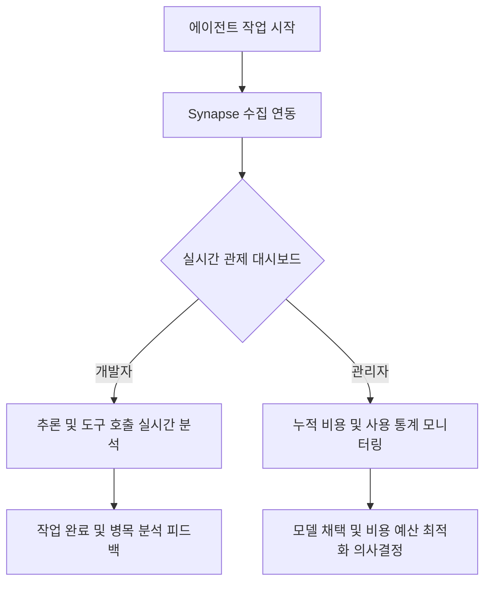

# Synapse: AI 에이전트 통합 모니터링 플랫폼 제품 기획 명세서 (PRD)

Synapse는 개발 조직 및 개별 개발자가 사용하는 다양한 AI 코딩 어시스턴트(Gemini, Claude, Copilot 등)의 작업 내역, 추론 과정, 도구 호출, 비용 등을 실시간으로 수집하고 분석하여 시각화해주는 **AI 에이전트 전용 관제 및 분석 플랫폼(Observability Platform)**입니다.

---

## 1. 제품 개요 및 비즈니스 배경 (Product Overview & Context)

### 1.1 시장의 문제점 (Problem Statement)
* **블랙박스화된 AI 행동**: AI 코딩 에이전트가 어떤 생각 흐름(Thought Trace)을 거쳐 코드를 수정하고 시스템 명령을 수행했는지 그 과정을 투명하게 추적하기 어렵습니다.
* **비용 통제 및 관리 부재**: 조직 내에서 여러 AI 에이전트를 혼용함에 따라 토큰 소비 패턴과 그에 따른 API 비용이 기하급수적으로 증가하지만, 이를 통합 관리할 수 있는 모니터링 도구가 부재합니다.
* **성과 측정의 어려움**: AI 에이전트 도입이 실제로 개발 생산성에 얼마나 기여하는지(어떤 도구 사용에 기여하고 어떤 작업에서 실패율이 높은지) 객관적 지표를 도출할 수 없습니다.

### 1.2 핵심 가치 제안 (Value Proposition)
* **신뢰성 확보 (Transparency)**: AI의 중간 추론과 시스템 제어 도구(Tool Call) 사용 이력을 타임라인으로 시각화하여 AI 작업 결과물에 대한 신뢰도 제고
* **비용 효율성 제고 (Cost Efficiency)**: 실시간 토큰 사용량 모니터링 및 모델별 예상 비용 시각화를 통해 자원 낭비 방지
* **개발 프로세스 최적화 (Analytics)**: 개발자가 가장 빈번하게 실패하는 병목 구간(마찰 지점)을 도출하여 AI 프롬프트 전략 및 워크플로우 개선

### 1.3 성공 지표 (KPIs)
* **사용자 고착도 (Retention)**: 주간 활성 개발자 수 (WAU) 및 대시보드 평균 체류 시간
* **생산성 기여도**: 세션당 평균 작업 완료 속도 및 세션 실패율(Error / Abort Rate) 개선율
* **비용 최적화 지표**: 중복 호출 및 과도한 컨텍스트 주입 방지를 통한 토큰 비용 절감 비율 (%)

---

## 2. 타겟 사용자 및 사용자 여정 (Target Persona & User Journey)

### 2.1 대상 사용자
* **엔터프라이즈 / 팀 리드 개발자 (Engineering Manager / PM)**:
  * 팀 내 AI 에이전트 도입률과 비용 소모 트렌드를 분석하고, AI 활용 보안 가이드라인 준수 여부를 모니터링하고자 하는 관리자.
* **AI 어시스턴트 헤비 유저 (Software Engineer)**:
  * 에이전트에게 장기 실행(Long-running Task) 작업을 맡겨 두고, 백그라운드에서 진행되는 작업 현황(성공/실패 여부, 막힌 구간)을 실시간으로 확인하려는 개발자.

### 2.2 핵심 사용자 여정 (User Journey)

---

## 3. 핵심 기능 요구사항 (Product Features)

### 📊 3.1 통합 관제 대시보드 (Unified Dashboard)
* **실시간 LLM 예산 및 비용 요약**: 
  * 설정된 일별/월별 예산 대비 현재 누적 예상 비용(USD)을 직관적인 게이지 차트로 제공.
  * 입력(Prompt) 토큰, 출력(Completion) 토큰, 캐시 적중률(Cached Tokens) 트렌드 시각화.
* **에이전트 활동성 스코어**: 
  * 현재 실행 중인 에이전트의 수, 대기 상태인 프로젝트 수의 실시간 라이브 카드.
* **도구 기여도 분석**: 
  * AI가 실행한 도구(검색, 코드 수정, 테스트 실행, 배포 등)의 유형별 비중을 시각화하여 어느 개발 단계에서 AI가 주로 쓰였는지 진단.

### 🗂️ 3.2 워크스페이스 및 세션 히스토리 관리 (Workspace & Session History)
* **프로젝트 단위 분류**: 
  * 로컬 또는 원격 저장소 기준의 워크스페이스별 에이전트 실행 상태 요약.
* **세션 상태 추적**: 
  * 각 에이전트가 실행된 고유 세션의 상세 메타데이터(모델명, 실행 성공/실패 여부, 소요 시간, 비용)를 리스트 형태로 제공.
  * 세션 상태에 따른 필터링(성공, 실패, 진행 중, 대기, 중단) 및 정렬 지원.

### 💬 3.3 입체적 인터랙션 뷰어 (Multidimensional Interaction Viewer)
* **생각의 흐름(Thought Trace) 타임라인**: 
  * AI가 최종 응답을 내놓기 전 거친 인지적 분석 과정을 단계별 카드로 배치하여, 개발자가 "AI가 왜 이런 해결책을 도출했는가"를 한눈에 이해하도록 함.
* **실시간 도구 호출 모니터링 (Tool Call Inspector)**: 
  * 시스템에 직접적인 영향을 주는 도구 실행(예: 파일 생성, 쉘 스크립트 실행 등) 단계의 입력 매개변수와 반환 결과를 안전하게 열람.
* **컨텍스트 하이라이팅 (Facets & Metadata)**: 
  * 각 대화 단계에서 발생한 에이전트의 궁극적 목표(Goal), 결과물(Outcome), 진행 중 직면한 마찰(Friction) 정보를 중요도에 따라 태그 형태로 시각화.

### ⚡ 3.4 실시간 동기화 및 알림 시스템 (Real-time Sync & Alerts)
* **지연 없는 스트리밍**: 
  * 에이전트의 작업 결과 및 생각이 수집되는 즉시 화면에 자연스럽게 흐르듯 반영(Streaming UX).
* **임계치 알림**: 
  * 특정 세션이 비정상적으로 길어지거나(Looping 감지), 단일 세션 비용이 사전에 정의한 임계치를 넘었을 때 화면 상에 즉각적인 주의(Warning) 모달 및 알림 노출.
* **연결 복구 가이드**: 
  * 에이전트와의 데이터 통신 채널이 끊겼을 때 사용자가 당황하지 않도록 자가 진단 및 재연결 가이드 단계 제공.

---

## 4. 핵심 비즈니스 데이터 모델 (Business Data Schema)

PM 관점에서 정의한 핵심 비즈니스 개체 및 관계 구조입니다.

| 엔티티명 | 설명 | 주요 정보 구성 |
| :--- | :--- | :--- |
| **프로젝트 (Project)** | 에이전트가 활동하는 최상위 개발 작업 공간 | 프로젝트 식별값, 프로젝트명, 물리적 위치 정보, 진행률(%), 참여 에이전트 유형 목록 |
| **세션 (Session)** | 단일 목표를 해결하기 위해 시작된 단일 실행 단위 | 세션 식별값, 연결 프로젝트 식별값, 사용된 LLM 모델, 진행 상태, 소모 비용, 메시지 수 |
| **메시지 (Message)** | 사용자와 AI, 그리고 시스템이 주고받은 상세 활동 원천 데이터 | 메시지 식별값, 메시지 유형(요청, 응답, 생각, 시스템로그), 토큰 상세 내역, 수행한 도구 이력 |

### 🔒 개인정보 보호 및 보안 기획 (Security & Compliance)
* **소스코드 마스킹**: 에이전트 로그 수집 시, 프로젝트 외부로 전송되는 모든 개인정보(이메일, API 키 등) 및 소스코드는 전송 단계 전 단계에서 마스킹 처리를 필수로 수행하여 데이터 유출 방지.
* **네트워크 투명성**: 외부 클라우드가 아닌 기업 내부망(On-Premise) 혹은 사용자 로컬 환경 내에서만 데이터를 보관하고 시각화할 수 있는 독립 모드 제공.

---

## 5. UI/UX 디자인 원칙 (Design Principles)

* **인지적 부하 최소화 (Low Cognitive Load)**: 
  * 에이전트의 수많은 실시간 데이터 중 가장 중요도가 높은 '진행 상태'와 '비용/진척도'를 최상단에 상시 배치.
* **친숙한 개발자 테마 (Developer-centric Aesthetics)**: 
  * 어두운 배경(Dark theme)을 기조로 하되, 액센트 컬러를 통일감 있게 배치하여 복잡한 로그 데이터를 스캔하는 피로도를 저감.
* **유연한 반응형 레이아웃**: 
  * 듀얼 모니터 환경에서 서브 모니터에 계속 켜두고 모니터링할 수 있는 '컴팩트 관제 모드'와 모든 지표를 깊게 분석하는 '와이드 분석 모드'를 유연하게 스위칭할 수 있도록 인터랙션 설계.
